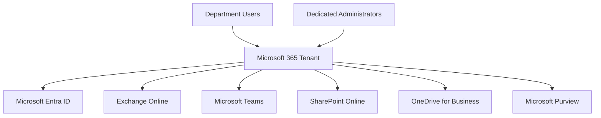
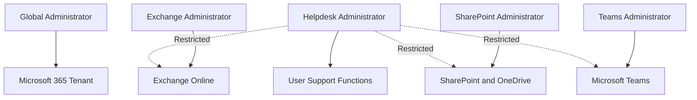
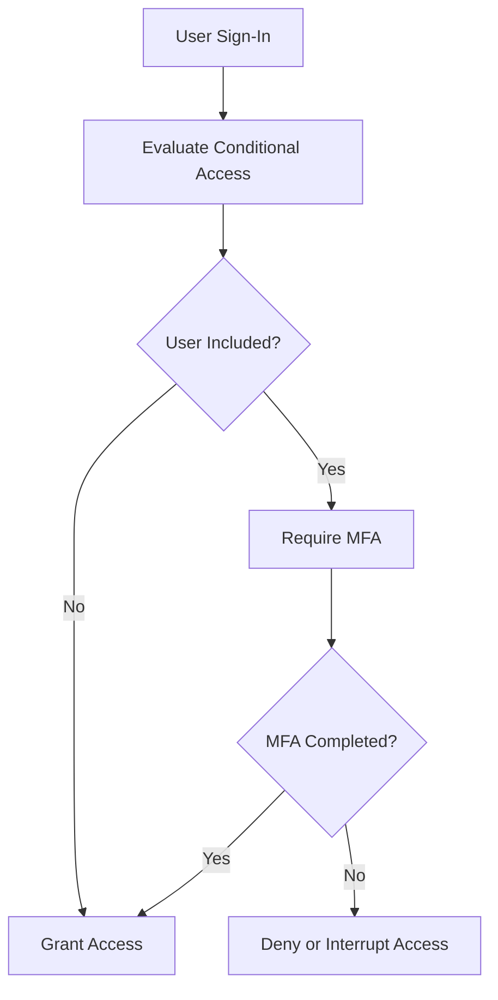
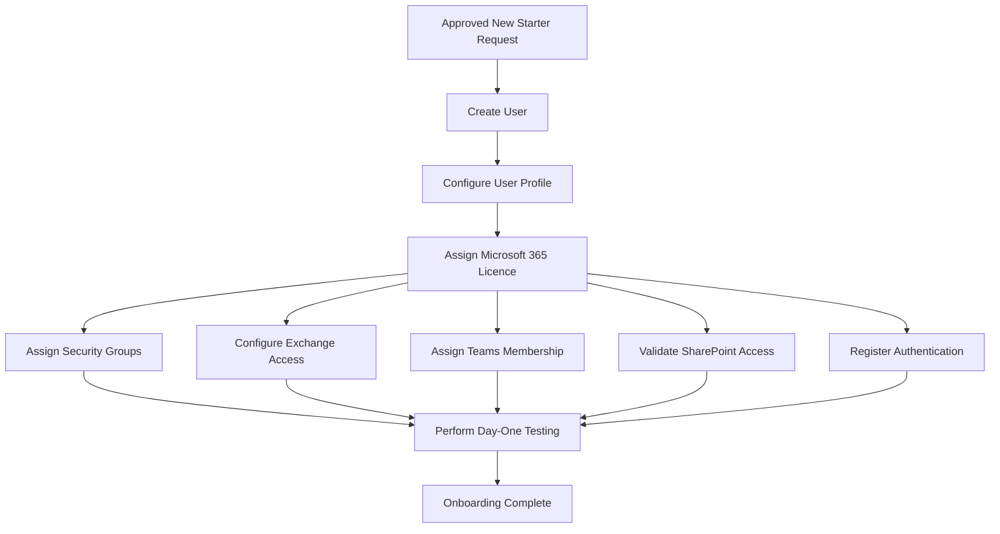
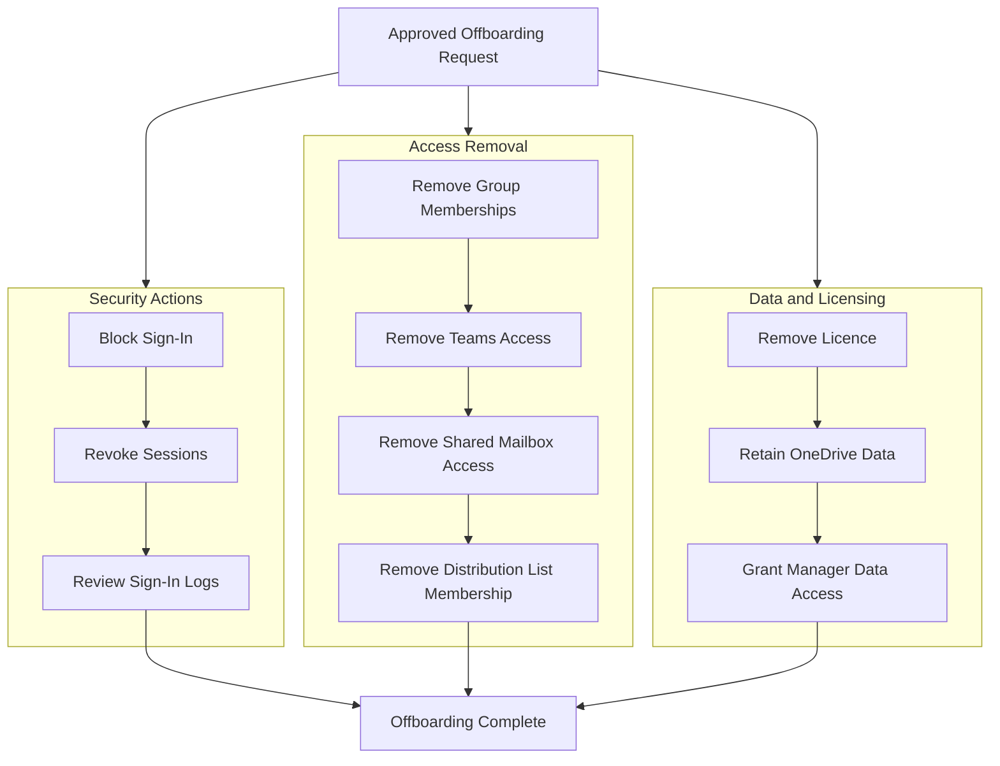

# Microsoft 365 Tenant Administration

## Overview

This section documents the deployment and administration of a Microsoft 365 tenant for the fictional organisation **Solotech Innovations**.

The project was designed to develop practical experience with:

- Microsoft 365 tenant administration
- Subscription and licence management
- User service provisioning
- Administrative role separation
- Microsoft 365 service validation
- User onboarding and offboarding
- Helpdesk administration
- Audit and sign-in monitoring

The tenant was built to support five business departments:

| Department | Abbreviation |
|---|---|
| Human Resources | HR |
| Information Technology | IT |
| Finance | FIN |
| Sales Operations | S.O |
| Customer Service Group | CSG |

---

## Project Objectives

The objectives of the Microsoft 365 tenant project were to:

1. Establish a functional Microsoft 365 environment.
2. Create and manage users across multiple departments.
3. Assign Microsoft 365 licences in bulk.
4. validate Exchange Online, Microsoft Teams, SharePoint Online, OneDrive for Business, and Microsoft Copilot access.
5. Implement administrative role separation.
6. Test user onboarding and offboarding.
7. Monitor administrative and user activity.
8. Prepare the tenant for hybrid identity integration.

---

## Tenant Service Architecture



---

## Subscription and Licence Administration

The environment initially used Microsoft 365 Business Standard licences.

Additional Microsoft Entra trial capabilities were later activated to support:

- Conditional Access
- Identity Protection
- Risky user investigation
- Risky sign-in investigation
- Privileged Identity features
- Microsoft Entra governance testing

The licence journey included:

1. Activating Microsoft 365 Business Standard.
2. Assigning licences to users in bulk.
3. Validating service provisioning.
4. Investigating unavailable Conditional Access controls.
5. Identifying that Entra ID Free did not provide Conditional Access.
6. Activating Microsoft Entra ID P2.
7. Activating Microsoft Entra Suite capabilities.
8. Assigning appropriate licences to administrative identities.

---

## Bulk Licence Assignment

Licences were assigned to users in bulk through the Microsoft 365 Admin Center.

### Process

1. Opened the Microsoft 365 Admin Center.
2. Navigated to **Users > Active users**.
3. Selected multiple users.
4. Opened the licence management action.
5. Assigned Microsoft 365 Business Standard.
6. Verified that service plans were enabled.
7. Confirmed licence propagation for each user.

### Services validated

- Exchange Online
- Outlook on the web
- Microsoft Teams
- SharePoint Online
- OneDrive for Business
- Microsoft Copilot
- Microsoft 365 web applications

### Licence Provisioning Flow


---

## User Service Validation

A test user from the tenant was used to confirm successful provisioning.

The following services were tested:

| Service | Validation |
|---|---|
| Outlook on the web | Mailbox opened and mail flow tested |
| Microsoft Teams | Department members and teams displayed |
| SharePoint Online | Team-connected site access confirmed |
| OneDrive for Business | Personal storage provisioned |
| Microsoft Copilot | Application available according to assigned entitlement |
| Microsoft 365 web apps | Browser-based applications opened successfully |

Provisioning delays were recognised as a normal part of Microsoft 365 administration. Some services became available sooner than others after licence assignment.

---

## Administrative Role Separation

A single Global Administrator account was initially used for all administrative work.

This was replaced with dedicated role-based administrator identities to support the principle of least privilege.

| Administrative identity | Microsoft Entra role | Primary responsibilities |
|---|---|---|
| Global administrator | Global Administrator | Tenant-wide emergency and configuration tasks |
| Exchange administrator | Exchange Administrator | Mailboxes, groups, mail flow, Exchange settings |
| SharePoint administrator | SharePoint Administrator | SharePoint Online and OneDrive administration |
| Teams administrator | Teams Administrator | Teams, channels, policies, and configuration |
| Helpdesk administrator | Helpdesk Administrator | Password resets and basic user support |

Multi-Factor Authentication was configured for all privileged accounts.

### Administrative Model



---

## RBAC Validation

Administrative access was tested using private browser sessions.

The Helpdesk Administrator account was used to confirm that least-privilege controls were working.

### Expected access

- View supported users
- Reset permitted user passwords
- Force supported users to sign out
- Perform basic account support

### Restricted access

- Microsoft Teams Admin Center
- SharePoint Admin Center
- Exchange organisation configuration
- Conditional Access administration
- Advanced security diagnostics
- Tenant-wide role management

The tests confirmed that assigning a role does not provide access outside the role's permitted administrative scope.

---

## Multi-Factor Authentication

Multi-Factor Authentication was configured for all administrative identities.

### Authentication method

- Microsoft Authenticator

### Administrative accounts protected

- Global Administrator
- Exchange Administrator
- SharePoint Administrator
- Teams Administrator
- Helpdesk Administrator

MFA testing was performed using the Helpdesk Administrator account. Successful, interrupted, and failed authentication attempts were reviewed in Microsoft Entra sign-in logs.

---

## Conditional Access

Microsoft Entra ID P2 enabled the creation of Conditional Access policies.

Two policies were created in report-only mode:

| Policy | Purpose |
|---|---|
| CA001 - Require MFA for Administrators | Require MFA for privileged identities |
| CA002 - Block Legacy Authentication | Identify and block legacy authentication clients |

Report-only mode was selected to evaluate impact before enforcement.

### Conditional Access Workflow



---

## User Onboarding

A structured onboarding process was developed for new users.

### Typical onboarding actions

1. Create user identity.
2. Populate department, job title, office location, and manager.
3. Set usage location.
4. Assign Microsoft 365 licence.
5. Add user to relevant security groups.
6. Add user to departmental distribution list.
7. Grant shared mailbox access.
8. Add user to the department Team.
9. Validate SharePoint access.
10. Register authentication methods.
11. Test sign-in and service access.

### Onboarding Workflow



---

## Temporary Auditor Scenario

A temporary Finance auditor account was created for a fictional user named Paul.

The account was granted:

- Microsoft 365 licence
- Finance Team membership
- Finance SharePoint access
- Finance Projects access
- Finance Payroll access
- Finance distribution list membership
- Finance shared mailbox access

The scenario was used to validate temporary access and the complete offboarding lifecycle.

---

## User Offboarding

The auditor account was later offboarded.

### Offboarding actions

1. Remove departmental group memberships.
2. Remove Teams membership.
3. Remove shared mailbox permissions.
4. Remove distribution list membership.
5. Test whether resource access had been withdrawn.
6. Remove the Microsoft 365 licence.
7. Observe service deprovisioning behaviour.
8. Disable the account.
9. Review sign-in and audit logs.

### Observed behaviour

- SharePoint access stopped after permission removal.
- Teams opened temporarily but contained no accessible teams.
- Outlook and SharePoint deactivated quickly after licence removal.
- OneDrive and some application access appeared temporarily because of caching and service propagation.
- Disabling the account prevented further authentication.

### Offboarding Workflow



---

## Audit and Sign-In Monitoring

Microsoft Entra sign-in logs and audit logs were reviewed throughout the project.

### Sign-in events reviewed

- Successful sign-in
- Failed sign-in
- Interrupted authentication
- MFA prompts
- Conditional Access evaluation
- Invalid credential attempts

### Administrative activity reviewed

- User creation
- User modification
- Group membership changes
- Licence changes
- Role assignments
- Password resets
- Sign-in blocking
- Account disablement

---

## Troubleshooting Experience

### Conditional Access unavailable

**Symptom:** Create policy option was unavailable.

**Cause:** The tenant had Microsoft Entra ID Free and Microsoft 365 Business Standard, but not Entra ID P1 or P2.

**Resolution:** Microsoft Entra ID P2 was activated and assigned appropriately.

---

### Licence removal did not immediately stop every application

**Symptom:** Teams, OneDrive, or Copilot functionality appeared temporarily after licence removal.

**Cause:** Cached sessions and asynchronous service entitlement processing.

**Resolution:** Access was tested after propagation, group memberships were removed, sessions were revoked, and the account was disabled.

---

### Role access testing

**Symptom:** Helpdesk Administrator could not access Teams Admin Center or advanced security diagnostics.

**Finding:** This was expected RBAC behaviour and confirmed least-privilege enforcement.

---

## Skills Developed

- Microsoft 365 tenant administration
- Licence and service plan management
- Bulk licence assignment
- Role-Based Access Control
- Multi-Factor Authentication
- Conditional Access
- User onboarding and offboarding
- Service provisioning validation
- Sign-in log investigation
- Audit log investigation
- Helpdesk administration
- Troubleshooting asynchronous cloud services

---

## Evidence Recommendations

Store supporting screenshots under:

```text
evidence/m365/
```

Recommended evidence:

| Screenshot | Suggested filename |
|---|---|
| Active users list | `m365-active-users.png` |
| Bulk licence assignment | `bulk-license-assignment.png` |
| Admin role accounts | `admin-role-accounts.png` |
| MFA authentication test | `admin-mfa-test.png` |
| Conditional Access policies | `conditional-access-policies.png` |
| Sign-in logs | `signin-log-analysis.png` |
| Auditor offboarding | `auditor-offboarding.png` |
