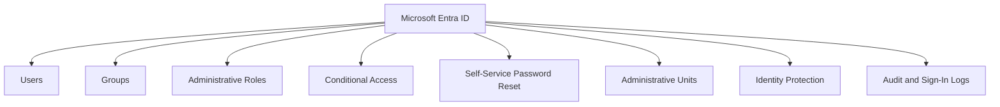
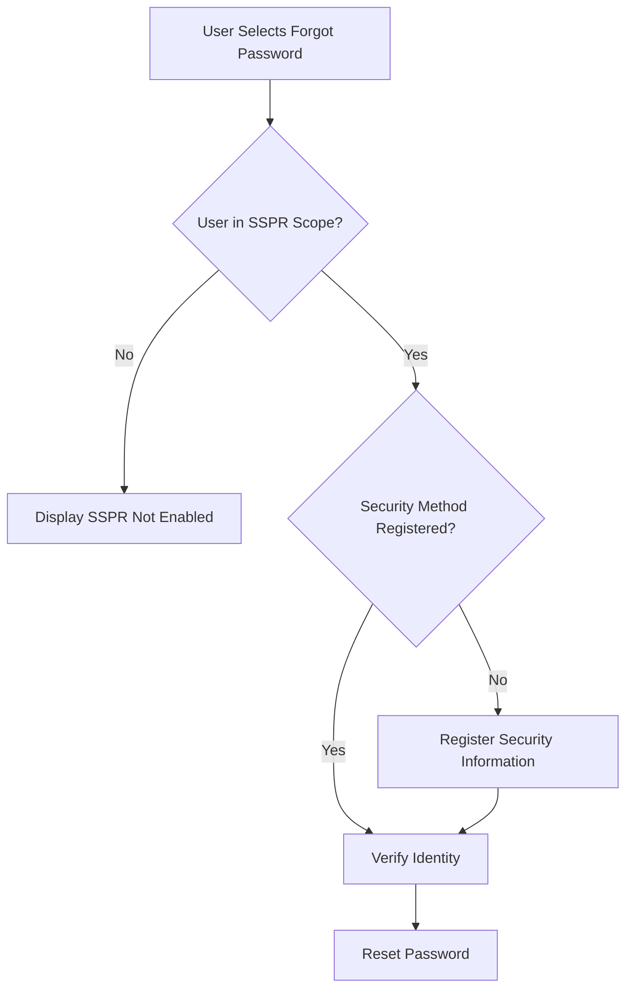
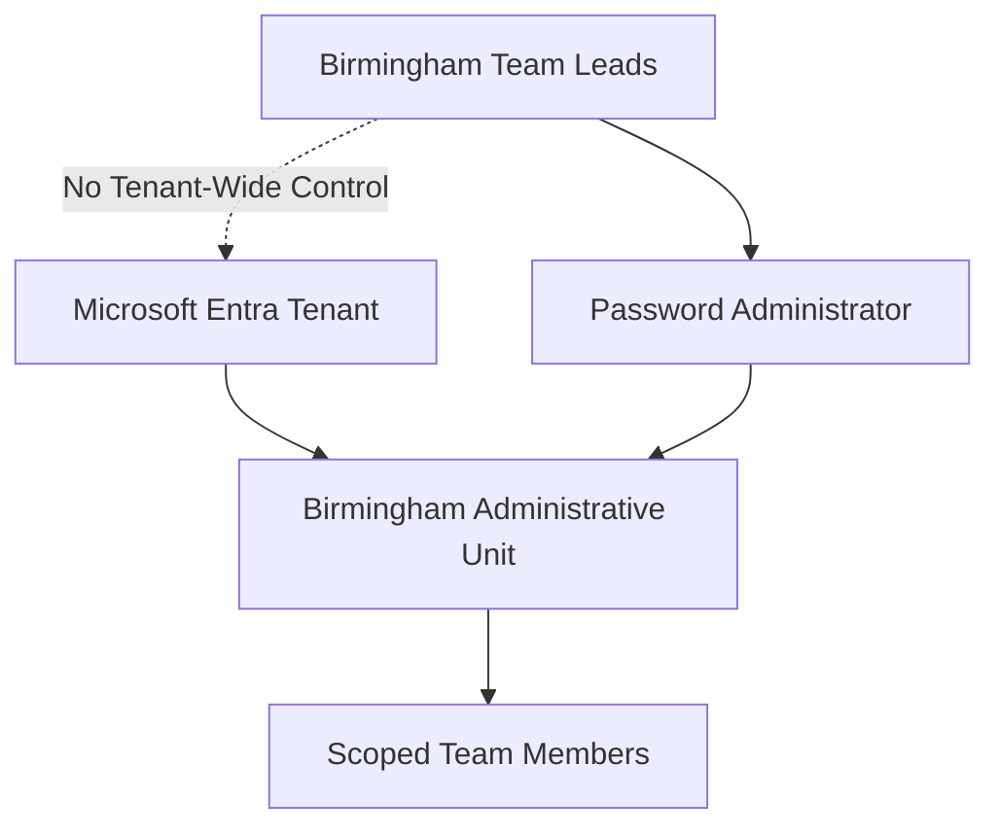
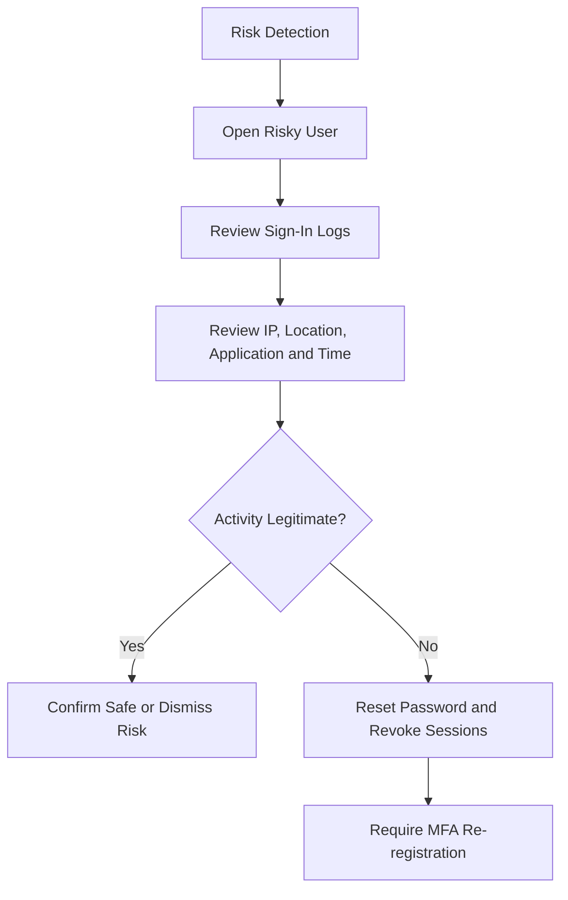

# Microsoft Entra ID Administration

## Overview

This section documents identity and access administration performed in Microsoft Entra ID for the Solotech Innovations Microsoft 365 lab.

The identity environment was built around five departments:

- Human Resources
- Information Technology
- Finance
- Sales Operations
- Customer Service Group

The project covered cloud identities, groups, administrative roles, Self-Service Password Reset, Administrative Units, Dynamic Membership, Conditional Access, Identity Protection, audit investigation, and hybrid identity preparation.

---

## Identity Architecture



---

## User Creation and Profile Administration

Twenty standard test users were created across the five departments.

User profiles included:

- Given name
- Surname
- Display name
- User Principal Name
- Department
- Job title
- Office location
- Usage location
- Manager
- Employee information where applicable

Populating identity attributes supported:

- Address book searches
- Dynamic group membership
- Microsoft Teams organisation information
- Administrative filtering
- Access management
- Future hybrid identity matching

---

## Department Structure

| Department | Example use |
|---|---|
| HR | Recruitment, policies, employee administration |
| IT | Service desk, administration, infrastructure support |
| Finance | Budgets, invoices, projects, payroll |
| Sales | Sales operations and customer engagement |
| CSG | Customer service and operational support |

---

## Security Groups

Departmental security groups were created to represent organisational access boundaries.

| Group | Purpose |
|---|---|
| HR-Team | HR access |
| IT-Team | IT access |
| Finance-Team | General Finance access |
| Finance-Payroll-Team | Restricted payroll access |
| Finance-Projects-Team | Finance project access |
| Sales-Team | Sales access |
| CSG-Team | Customer service access |

These groups were used to model role-based access control.

---

## Group Administration Strategy

The lab used several group types for different purposes.

| Group type | Purpose |
|---|---|
| Security group | Access control and permissions |
| Microsoft 365 group | Collaboration, Teams, SharePoint |
| Mail-enabled security group | Email and security-enabled access |
| Distribution list | Department-wide email communication |
| Dynamic membership group | Automatic membership based on identity attributes |

The project demonstrated that no single group type is ideal for every Microsoft 365 workload.

---

## Dynamic Membership

Dynamic membership rules were tested using user profile attributes.

### Example rule

```text
user.department -eq "Finance"
```

### Outcome

When a user was created with:

```text
Department = Finance
```

the user became eligible for automatic membership of the relevant dynamic group.

### Dynamic Membership Flow


---

## Administrative Roles

Dedicated administrator identities were created rather than using the Global Administrator account for routine work.

| Role | Functional scope |
|---|---|
| Global Administrator | Tenant-wide administration |
| Exchange Administrator | Exchange Online |
| SharePoint Administrator | SharePoint and OneDrive |
| Teams Administrator | Teams administration |
| Helpdesk Administrator | Password and user support |

Role validation confirmed that administrators could perform only their delegated responsibilities.

---

## Role-Based Access Testing

The Helpdesk Administrator account was tested against several administrative workloads.

### Allowed

- Basic supported-user administration
- Password resets within scope
- Session revocation where permitted

### Denied

- Teams Admin Center
- SharePoint administration
- Exchange organisation configuration
- Security diagnostic data
- Conditional Access administration

This demonstrated least-privilege access in practice.

---

## Multi-Factor Authentication

MFA was configured for all administrative identities through Microsoft Authenticator.

MFA activity was investigated through sign-in logs.

Events reviewed included:

- Authentication successful
- Authentication interrupted
- Authentication failed
- User interaction required
- Invalid username or password
- Conditional Access evaluation

---

## Self-Service Password Reset

SSPR was deployed as a targeted pilot rather than for all users.

### Target group

```text
FIN-Team-M365
```

### Test outcomes

| Test user | Result |
|---|---|
| Finance user inside scope | SSPR available but registration required |
| HR user outside scope | SSPR not enabled for the account |

The tests confirmed that SSPR targeting was working correctly.

The Finance user was required to register an approved authentication method before completing password reset.

### SSPR Flow



---

## Helpdesk Notification Workflow

Password assistance requests generated email notifications for:

- Helpdesk Administrator
- IT support group

This demonstrated integration between identity recovery and the service desk workflow.

---

## Administrative Units

An Administrative Unit was created to delegate administrative control over a limited user population.

### Scenario

Birmingham team leads required permission to reset passwords for team members without receiving tenant-wide administrative access.

### Configuration

- Created Birmingham Administrative Unit.
- Added the relevant user population.
- Assigned two managers as scoped administrators.
- Assigned the Password Administrator role.
- Tested restrictive management behaviour.

### Role assessment

Password Administrator was appropriate for controlled password-reset delegation.

The restrictive Administrative Unit option was also tested. Restrictive management increased protection but reduced later flexibility because management boundaries became more difficult to modify after configuration.

### Administrative Unit Model



---

## Conditional Access

Microsoft Entra ID P2 was activated to enable Conditional Access.

Policies created:

| Policy | State |
|---|---|
| CA001 - Require MFA for Administrators | Report-only |
| CA002 - Block Legacy Authentication | Report-only |

Report-only mode allowed safe evaluation before enforcement.

Break-glass account planning was also introduced to reduce the risk of administrator lockout.

---

## Identity Protection

Microsoft Entra Identity Protection was used to investigate:

- Risky users
- Risky sign-ins
- Risk detections
- Anomalous token activity

### Investigation process



---

## Audit and Sign-In Logs

The following identity operations were reviewed:

- User creation
- User changes
- Group membership changes
- Role assignments
- Licence changes
- Password resets
- MFA registration
- Successful sign-ins
- Failed sign-ins
- Interrupted sign-ins
- Conditional Access decisions

The investigation process focused on:

```text
Who performed the action?
What operation was performed?
When did it occur?
Which application was involved?
What was the result?
Which IP address was used?
```

---

## Hybrid Identity Preparation

Before Microsoft Entra Connect synchronization, the on-premises User Principal Name suffix was updated.

### Previous UPN

```text
user@solotech.local
```

### Corrected UPN

```text
user@solotechinnovations.onmicrosoft.com
```

This enabled identity matching between Active Directory and existing Microsoft Entra cloud identities.

The project later demonstrated:

- Successful soft matching
- Duplicate identity creation
- Direct role assignment impact
- Identity remediation
- Source of Authority transfer to Active Directory

The full hybrid identity project is documented separately.

---

## Troubleshooting Experience

### Conditional Access creation unavailable

**Cause:** Entra ID Free did not include Conditional Access.

**Resolution:** Microsoft Entra ID P2 was activated.

### SSPR results differed by department

**Cause:** SSPR was deliberately scoped only to Finance.

**Resolution:** Confirmed expected behaviour by testing an included Finance user and excluded HR user.

### Restrictive Administrative Unit limitations

**Finding:** Restrictive management increased protection but reduced the ability to change some management properties later.

### Dynamic group processing

**Finding:** Accurate identity attributes were essential. A misspelt or missing department value prevented automatic membership.

---

## Skills Developed

- Microsoft Entra user administration
- Identity attribute management
- Security and Microsoft 365 groups
- Dynamic membership rules
- Administrative role assignment
- Administrative Units
- Self-Service Password Reset
- Multi-Factor Authentication
- Conditional Access
- Identity Protection
- Risk investigation
- Audit and sign-in analysis
- Least-privilege administration

---

## Evidence Recommendations

Store screenshots under:

```text
evidence/entra-id/
```

Recommended screenshots:

| Evidence | Filename |
|---|---|
| User directory | `entra-users.png` |
| Department security groups | `department-security-groups.png` |
| Dynamic group rule | `dynamic-finance-rule.png` |
| Administrator roles | `administrative-roles.png` |
| Helpdesk access denied | `rbac-helpdesk-denied.png` |
| SSPR Finance test | `sspr-finance-user.png` |
| SSPR HR exclusion | `sspr-hr-user.png` |
| Administrative Unit | `birmingham-administrative-unit.png` |
| Conditional Access policies | `conditional-access-report-only.png` |
| Risky user investigation | `identity-protection-risk.png` |
