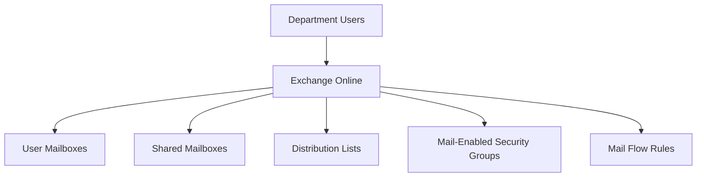
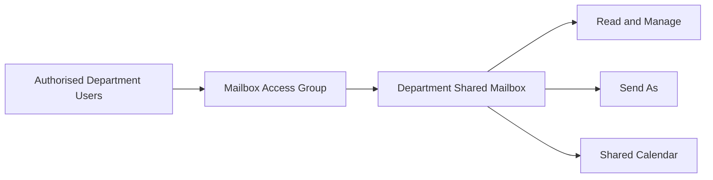
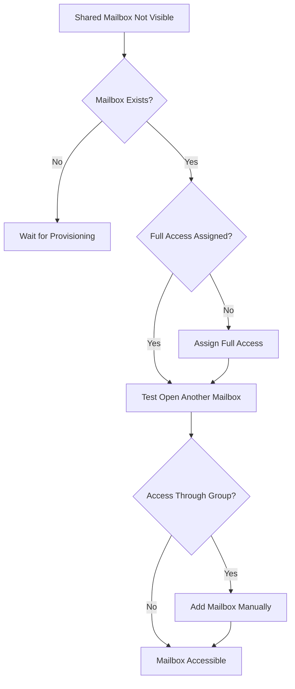
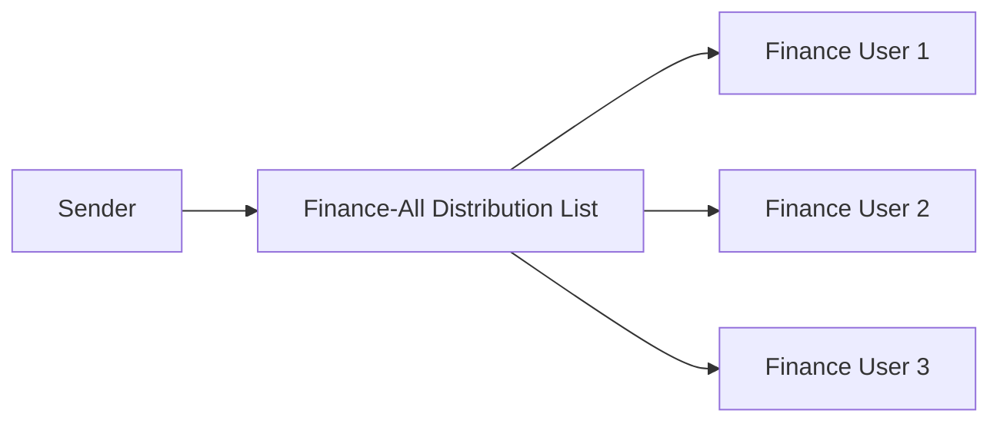
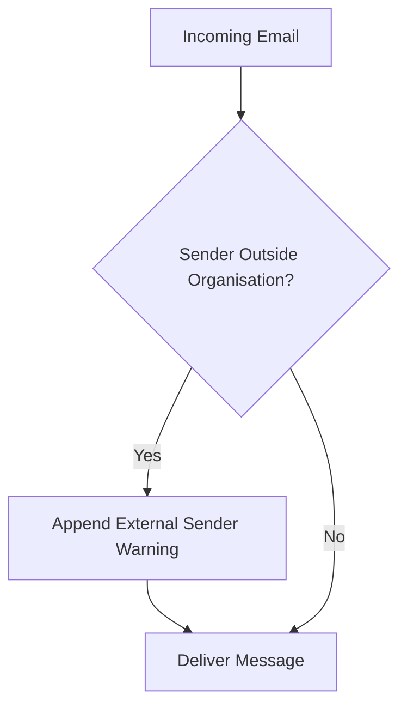

# Exchange Online Administration

## Overview

This section documents Exchange Online administration completed for the Solotech Innovations Microsoft 365 lab.

The project covered:

- Exchange Online mailbox provisioning
- Shared mailbox deployment
- Mailbox delegation
- Mail-enabled security groups
- Distribution lists
- Mail flow rules
- External sender warnings
- Outlook on the web testing
- Mailbox access troubleshooting
- Group-based Exchange administration
- User onboarding and offboarding

---

## Exchange Architecture



---

## Mailbox Provisioning

Licensed users were checked in Exchange Admin Center to verify mailbox creation.

### Provisioning checks

- Mailbox exists
- Primary SMTP address is correct
- User can open Outlook on the web
- User can send and receive email
- User appears in address searches
- Licence contains Exchange Online service plan

Provisioning delays were considered during testing.

---

## Shared Mailboxes

Departmental shared mailboxes were created for:

| Department | Shared mailbox purpose |
|---|---|
| HR | HR departmental enquiries |
| IT | IT support and service requests |
| Finance | Finance departmental communication |
| Sales | Sales enquiries |
| CSG | Customer service communication |

Examples included:

```text
hr@
support@
finance@
sales@
csg@
```

---

## Shared Mailbox Permissions

Mailbox delegation included:

- Read and Manage, also known as Full Access
- Send As
- Send on Behalf, where required

### Shared Mailbox Model



---

## Outlook on the Web Access

Shared mailbox access was tested through Outlook on the web.

Access methods included:

1. Open another mailbox.
2. Add shared folder or mailbox.
3. Direct mailbox opening.
4. Delegated access through Full Access permissions.

It was observed that shared mailbox auto-mapping was not reliable when permissions were granted through groups. Users could still manually search for and add the mailbox.

---

## Shared Mailbox Troubleshooting

### Issue

A newly created shared mailbox did not appear automatically in Outlook on the web.

### Investigation

- Confirmed mailbox existence in Exchange Admin Center.
- Confirmed delegated permissions.
- Tested Open another mailbox.
- Tested Add shared folder or mailbox.
- Reviewed associated Entra object.
- Considered Exchange provisioning delay.
- Compared direct user permissions with group-based delegation.

### Key finding

Auto-mapping is more reliable with direct Full Access assignment than with group-based permissions.

Group-based access was retained because it simplified onboarding and offboarding, but users might need to add the shared mailbox manually.

### Troubleshooting Flow



---

## Mail-Enabled Security Groups

Mail-enabled security groups were created for departmental Exchange access.

Purpose:

- Reduce individual permission assignment.
- Simplify onboarding.
- Simplify offboarding.
- Support email distribution.
- Provide a group-based access model.

Example structure:

```text
Finance users
    ↓
Finance mailbox access group
    ↓
Finance shared mailbox
```

The Exchange Admin Center interface did not always allow standard Entra security groups to be selected for mailbox delegation. Exchange-compatible mail-enabled groups were therefore used where appropriate.

---

## Distribution Lists

Departmental distribution lists were created for:

- HR
- IT
- Finance
- Sales
- CSG

### Example

```text
Finance-All
```

Messages sent to the list were delivered to Finance members.

### Distribution Testing

- Added department members.
- Sent test mail to each list.
- Confirmed all intended recipients received the message.
- Confirmed unrelated departments did not receive the message.
- Tested membership removal.

### Distribution Flow



---

## Group Design Lessons

The lab highlighted the difference between:

| Group | Best use |
|---|---|
| Entra security group | General access control |
| Mail-enabled security group | Security permissions and email |
| Distribution list | Email distribution |
| Microsoft 365 group | Collaboration, mailbox, SharePoint and Teams |

Separate groups were used where access requirements differed. For example, general Finance membership was kept separate from Finance Payroll access.

---

## External Sender Disclaimer

An Exchange mail flow rule was created to append an external sender warning to messages originating outside the organisation.

### Rule logic

**Condition:**

```text
Sender is located outside the organisation
```

**Action:**

```text
Append an external sender disclaimer
```

The internal-sender exception was found to be redundant because the original condition already selected external senders only.

### Mail Flow Rule



---

## External Sender Warning Purpose

The rule was intended to:

- Increase phishing awareness
- Warn users before opening links or attachments
- Distinguish external mail from internal messages
- Support user security education

Example wording:

```text
Warning: This message originated outside the organisation.
Verify the sender before opening attachments or following links.
```

---

## Temporary Auditor Mail Access

The Finance auditor account was granted:

- Finance shared mailbox access
- Finance distribution list membership
- Finance mailbox group membership

Access was tested before and after group removal.

The exercise confirmed that group-based membership could simplify temporary access administration.

---

## Offboarding Validation

During offboarding:

1. The user was removed from departmental distribution lists.
2. Shared mailbox permissions were removed.
3. Departmental mail-enabled group membership was removed.
4. Mail access was retested.
5. The Microsoft 365 licence was removed.
6. The account was disabled.

Exchange Online access became unavailable after licence and sign-in changes propagated.

---

## Proxy Addresses and Mail Nicknames

During later hybrid identity troubleshooting, Exchange-related identity attributes were reviewed:

- Primary SMTP address
- Secondary SMTP aliases
- Mail attribute
- Mail nickname
- User Principal Name

This demonstrated that Exchange attributes are important during cloud and hybrid identity migrations.

---

## Troubleshooting Summary

| Issue | Cause or finding | Resolution |
|---|---|---|
| Shared mailbox not visible | Auto-mapping delay or group-based access | Manually add mailbox and confirm Full Access |
| Standard security group unavailable | Not Exchange-enabled | Use a mail-enabled security group |
| Distribution messages not received | Membership or propagation | Review membership and retest |
| External disclaimer not visible | Rule scope or propagation | Confirm sender is external and rule is enabled |
| Exchange access ended after licence removal | Expected service deprovisioning | Validate during offboarding |
| Duplicate identity mail attributes | UPN or proxy mismatch | Align identity attributes before hybrid sync |

---

## Skills Developed

- Exchange Online administration
- User mailbox validation
- Shared mailbox creation
- Full Access and Send As delegation
- Mail-enabled security groups
- Distribution list administration
- Mail flow rule creation
- External sender protection
- Outlook on the web troubleshooting
- Exchange identity attributes
- Onboarding and offboarding
- Group-based access control

---

## Evidence Recommendations

Store screenshots under:

```text
evidence/exchange/
```

Recommended screenshots:

| Evidence | Filename |
|---|---|
| Shared mailbox list | `shared-mailboxes.png` |
| Mailbox delegation | `finance-mailbox-delegation.png` |
| Distribution lists | `department-distribution-lists.png` |
| Distribution mail test | `distribution-mail-test.png` |
| Mail-enabled groups | `mail-enabled-security-groups.png` |
| External disclaimer rule | `external-sender-rule.png` |
| External message banner | `external-sender-warning.png` |
| Outlook shared mailbox | `outlook-shared-mailbox.png` |
