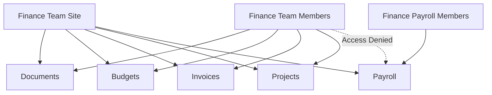
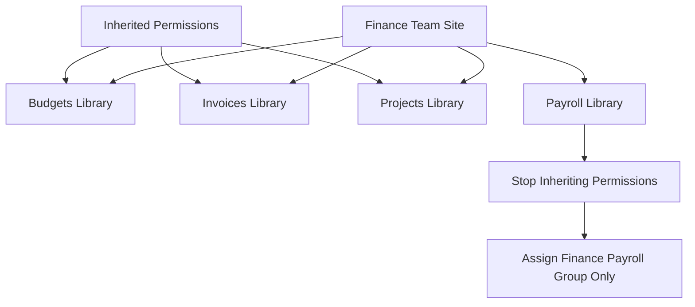
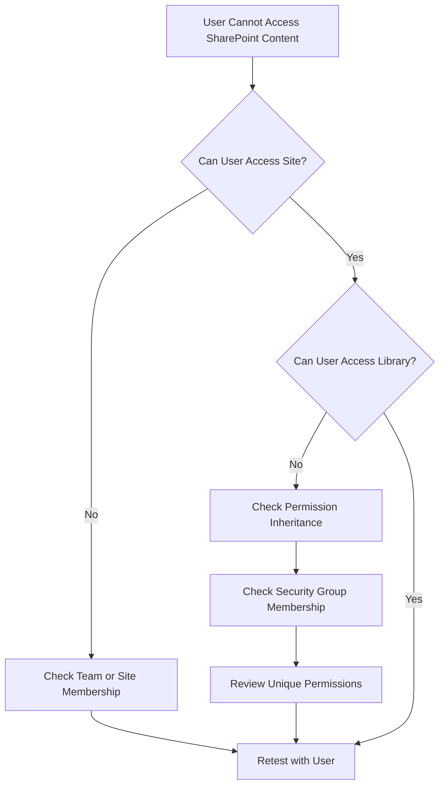

# SharePoint Online Administration

## Overview

This section documents the design, deployment, permissions configuration, testing, and troubleshooting of SharePoint Online sites for the Solotech Innovations Microsoft 365 lab.

The project focused on:

- Team-connected SharePoint sites
- Departmental site isolation
- Document library creation
- Permission inheritance
- Unique library permissions
- Restricted Finance Payroll access
- Cross-department access testing
- OneDrive and SharePoint integration
- User offboarding and data access

---

## SharePoint and Teams Relationship

Each Microsoft Team created a connected Microsoft 365 group and SharePoint Online team site.


---

## Departmental Sites

SharePoint sites were created or automatically provisioned for:

| Department |
|---|
| Human Resources |
| Information Technology |
| Finance |
| Sales |
| Customer Service Group |

Each department site was restricted to its authorised members.

Cross-department testing confirmed that users from unrelated departments could not access sites to which they had not been added.

---

## Finance Team Site

The Finance Team site was used for detailed permissions and library administration testing.

Document libraries created:

| Library | Purpose |
|---|---|
| Budgets | Budget documents |
| Invoices | Invoice records |
| Projects | Finance project documentation |
| Payroll | Restricted payroll information |

---

## Finance Site Architecture



---

## Creating Document Libraries

Libraries were created within the **Finance Team SharePoint site**, not within Teams Admin Center.

### Process

1. Opened SharePoint Admin Center.
2. Selected **Sites > Active sites**.
3. Opened the Finance Team site.
4. Selected **New**.
5. Selected **Document library**.
6. Created a blank library.
7. Added a name and description.
8. Repeated for Budgets, Invoices, Projects, and Payroll.

The default Documents library remained available for standard Team channel files.

---

## SharePoint Permission Model

SharePoint permissions were managed through:

- Site Owners
- Site Members
- Site Visitors
- Library-level inheritance
- Unique library permissions
- Security group membership

### Default behaviour

New libraries inherited permissions from the parent Finance Team site.

This meant that Finance Team owners and members could access inherited libraries.

---

## Payroll Library Restriction

The Payroll library required tighter access than the rest of the Finance site.

### Requirement

General Finance users should access:

- Budgets
- Invoices
- Projects

Only payroll-authorised users should access:

- Payroll

### Implementation

1. Opened the Payroll library.
2. Opened library permissions.
3. Stopped inheriting permissions from the Finance Team site.
4. Removed general Finance access where required.
5. Added the Finance Payroll security group.
6. Tested with payroll and non-payroll users.

### Result

| User type | Payroll access |
|---|---|
| Finance Payroll member | Allowed |
| General Finance member | Denied |
| HR user | Denied |
| Sales user | Denied |
| CSG user | Denied |

---

## Permission Inheritance Model



---

## Access Validation

Multiple accounts were used for validation.

### General Finance user

- Could access Finance site.
- Could access Budgets.
- Could access Invoices.
- Could access Projects.
- Could not access Payroll.

### Finance Payroll user

- Could access general Finance libraries.
- Could access Payroll.

### Non-Finance user

- Could not access the Finance Team site.
- Could not browse Finance libraries.
- Could not access Payroll.

---

## Temporary Auditor Scenario

A temporary Finance auditor user was granted access to:

- Finance Team site
- Finance Projects
- Finance Payroll
- Finance Team
- Finance shared mailbox
- Finance distribution list

The account was used to test:

- Temporary elevated business access
- Access through group membership
- File access
- File editing
- Version history
- Removal of access after the audit

---

## File Activity Testing

The following file activities were performed:

- File creation
- File upload
- File edit
- File rename
- File download
- File deletion
- Recycle Bin restoration
- Version history review

A test payroll file was used to generate auditable activity.

---

## File Recovery

Deleted files were restored from the SharePoint Recycle Bin.

This demonstrated that file deletion did not immediately result in permanent loss.

### Recovery Workflow


---

## SharePoint and Microsoft Purview

Controlled SharePoint activity was later generated for Purview auditing.

Actions included:

- Creating Payroll files
- Editing files
- Renaming files
- Deleting files
- Restoring files
- Changing permissions

This created a known data set for audit investigation.

---

## OneDrive Relationship

The project established that OneDrive for Business is implemented as a personal SharePoint site.

This became important when delegating access to the OneDrive of an offboarded user.

The successful access method used:

```text
SharePoint Admin Center
> More Features
> User Profiles
> Manage User Profiles
> Manage Site Collection Owners
```

The Finance Manager was granted site collection-level access to the departed auditor's OneDrive.

---

## Troubleshooting Experience

### Incorrect initial permissions guidance

The modern SharePoint interface did not match the expected navigation path.

The working permissions process was identified through the library permissions interface and unique permission configuration.

### Payroll content accessible too widely

**Cause:** The library was inheriting permissions from the Finance Team site.

**Resolution:** Permission inheritance was stopped and Finance Payroll access was assigned.

### Non-Finance users accessing Finance content

**Test result:** Access was denied, confirming department isolation.

### Manager could not access departed user's OneDrive

**Cause:** A generated sharing link did not provide site-level administrative access.

**Resolution:** The manager was added through SharePoint User Profiles as a Site Collection Administrator.

---

## SharePoint Troubleshooting Flow



---

## Skills Developed

- SharePoint site administration
- Team-connected site management
- Document library creation
- Permission inheritance
- Unique permissions
- Security group-based access
- Department isolation
- Sensitive data segregation
- SharePoint Recycle Bin recovery
- Version history
- OneDrive site collection access
- Access troubleshooting
- Microsoft Purview activity generation

---

## Evidence Recommendations

Store screenshots under:

```text
evidence/sharepoint/
```

Recommended screenshots:

| Evidence | Filename |
|---|---|
| Active SharePoint sites | `active-sharepoint-sites.png` |
| Finance libraries | `finance-document-libraries.png` |
| Payroll unique permissions | `payroll-unique-permissions.png` |
| Finance user denied Payroll | `finance-payroll-access-denied.png` |
| Payroll user granted access | `payroll-member-access.png` |
| Cross-department denial | `department-isolation-test.png` |
| Recycle Bin restore | `sharepoint-file-restore.png` |
| OneDrive site owners | `onedrive-site-collection-admin.png` |
