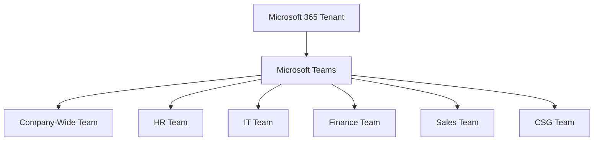
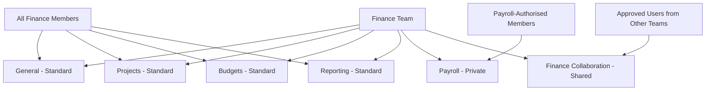
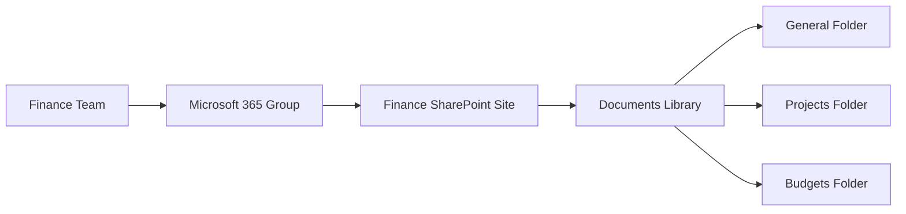
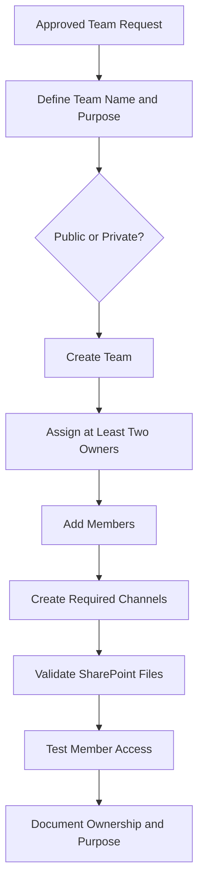
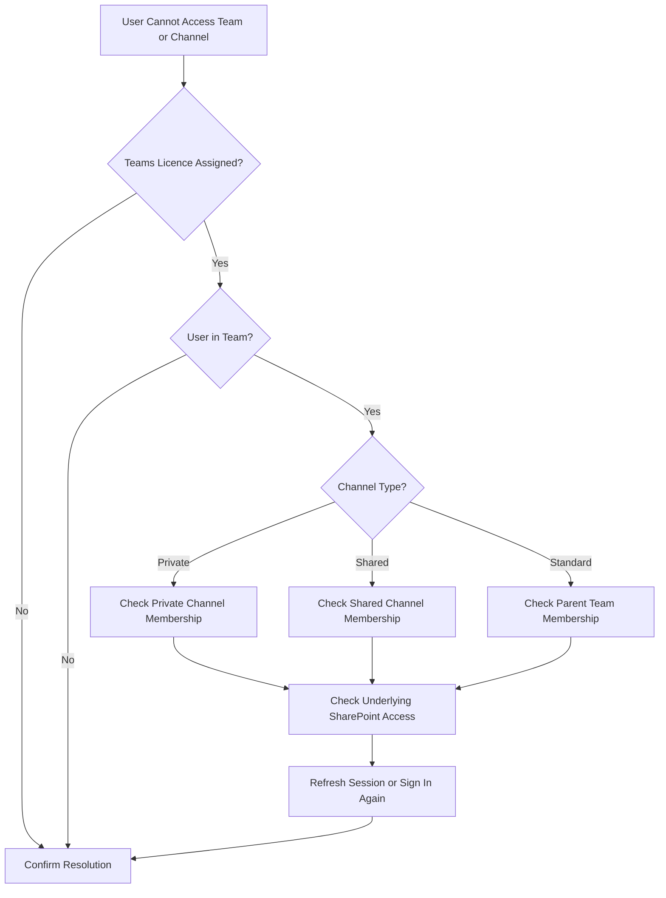

# Microsoft Teams Administration

## Overview

This section documents Microsoft Teams deployment and administration for the Solotech Innovations Microsoft 365 lab.

The project covered:

- Public and private Teams
- Department Team creation
- Standard channels
- Private channels
- Shared channels
- Team owners and members
- Membership limitations
- SharePoint integration
- Restricted Finance collaboration
- Helpdesk troubleshooting
- Teams activity generation for auditing

---

## Teams Environment

Department Teams were created for:

| Team | Visibility |
|---|---|
| Company-wide Team | Public |
| HR Team | Private |
| IT Team | Private |
| Finance Team | Private |
| Sales Team | Private |
| CSG Team | Private |

The private department Teams restricted access to authorised members.

---

## Teams Architecture



---

## Public and Private Teams

### Public Team

The company-wide Team was created as public to support organisation-wide collaboration.

### Private Teams

Department Teams were configured as private.

Only approved members could:

- Discover department content
- Access channels
- View files
- Participate in Team conversations
- Access the connected SharePoint site

---

## Team Membership

Members were added through Microsoft Teams or Teams Admin Center.

An important limitation was identified:

- Teams Admin Center primarily accepted individual users.
- Existing Entra security groups could not always be added directly as Team members.
- Membership changes were performed in batches where the portal imposed limits.

This highlighted the difference between:

- Entra security group membership
- Microsoft 365 group membership
- Team membership

For larger environments, PowerShell, Microsoft Graph, dynamic Microsoft 365 groups, or lifecycle automation would reduce manual administration.

---

## Finance Team Design

The Finance Team was used to test all major channel types.

### Standard channels

- General
- Projects
- Budgets
- Reporting

### Private channel

- Payroll

### Shared channel

- Finance Collaboration or cross-department collaboration channel

---

## Finance Team Structure



---

## Standard Channels

Standard channels were visible to all members of the parent Team.

They were used for:

- General department communication
- Finance projects
- Budget collaboration
- Reporting discussions

Files uploaded to standard channels were stored in folders within the connected SharePoint site's Documents library.

---

## Private Channels

The Payroll private channel was created for sensitive collaboration.

Only specifically selected Team members could access the private channel.

The private channel scenario represented content such as:

- Payroll operations
- Salary information
- Sensitive Finance discussions
- Restricted management collaboration

Private channel membership was tested independently from general Finance Team membership.

---

## Shared Channels

A shared channel was created to test collaboration without granting users full membership of the Finance Team.

This represented a scenario where users from another department might need access to a specific Finance project but should not gain access to all Finance content.

---

## Teams and SharePoint Integration

Every Team was linked to a Microsoft 365 group and SharePoint site.

### Relationship



Understanding this relationship was important because many Teams file-access issues were actually SharePoint permission issues.

---

## File Collaboration

The following Teams activities were tested:

- Uploading files
- Editing files
- Sharing files
- Posting messages
- Creating channel folders
- Opening files through Teams
- Opening underlying files through SharePoint

The project confirmed that Teams file storage depends on SharePoint Online.

---

## Temporary Auditor Access

The temporary Finance auditor account was added to:

- Finance Team
- Finance Payroll resources
- Finance Projects
- Finance collaboration resources

The auditor's access was later removed to test:

- Team membership removal
- Channel access withdrawal
- SharePoint access withdrawal
- Cached Teams client behaviour

After membership removal, Teams remained accessible as an application for a period, but the user had no department Teams listed.

---

## Teams Administrator Role Testing

A dedicated Teams Administrator identity was created.

The account was used to access Teams Admin Center and manage allowed Teams functions.

The Helpdesk Administrator account was tested against Teams Admin Center and received an insufficient privilege error.

This confirmed role separation.

---

## Membership Limitations and Enterprise Alternatives

The lab identified the operational cost of manually adding Team members.

Potential enterprise improvements include:

### Microsoft Graph

Automate user addition and removal.

### PowerShell

Use Teams and Microsoft Graph cmdlets for membership operations.

### Dynamic Microsoft 365 groups

Use attributes such as Department to populate membership automatically.

### Identity Governance

Use access packages, approval workflows, and access reviews where licensing permits.

---

## Team Lifecycle Workflow



---

## Troubleshooting Experience

### Security group could not be added directly

**Finding:** Teams Admin Center expected user or Microsoft 365 group membership rather than arbitrary security-group nesting.

**Approach:** Users were added individually or through the Team's Microsoft 365 group membership.

### Teams application opened after licence removal

**Finding:** Client sessions and cached application state remained temporarily.

**Validation:** The user had no Team resources and later lost service entitlement.

### Finance user could not access Payroll

**Cause:** User was not a member of the private channel or restricted SharePoint permissions.

**Resolution:** Checked Team membership, private channel membership, and underlying SharePoint access.

### Helpdesk Administrator denied Teams Admin Center

**Finding:** Expected least-privilege behaviour.

---

## Teams Troubleshooting Flow



---

## Audit Activity

Teams activity was generated for Microsoft Purview testing.

Activities included:

- Team activity
- Channel creation
- Channel messages
- File uploads
- Folder creation
- Collaboration actions

A dedicated Audit Testing channel was created to establish a known audit trail.

---

## Skills Developed

- Microsoft Teams administration
- Public and private Team design
- Team ownership
- Membership administration
- Standard channels
- Private channels
- Shared channels
- Teams and SharePoint integration
- Restricted collaboration
- RBAC validation
- Teams access troubleshooting
- User onboarding and offboarding
- Audit activity generation

---

## Evidence Recommendations

Store screenshots under:

```text
evidence/teams/
```

Recommended screenshots:

| Evidence | Filename |
|---|---|
| Teams list | `department-teams.png` |
| Public company Team | `public-company-team.png` |
| Private Finance Team | `private-finance-team.png` |
| Standard channels | `finance-standard-channels.png` |
| Payroll private channel | `payroll-private-channel.png` |
| Finance shared channel | `finance-shared-channel.png` |
| Teams membership | `finance-team-membership.png` |
| Helpdesk access denied | `helpdesk-teams-admin-denied.png` |
| Audit Testing channel | `teams-audit-testing.png` |
